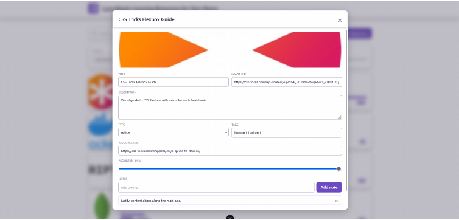
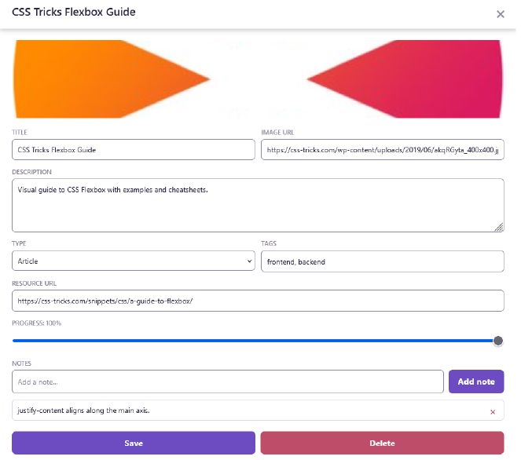

# Project 3 learn-vue-state
This is part of CAT3.

# Requirements
In this PEC, we will address the management of states and events of the components created in the previous task. In summary, the functionality we will implement is as follows: Our application data resides in App.vue**,** therefore, **we need to create a form** that emits an event with the information of the created item so that it can be captured by the App component and then the list of items can be updated, instead of using sample values. 

| *Note* |
| :---- |
| *The test elements performed in the previous exercise must be maintained in this exercise, so that when the app starts for the first time, it is not empty.* |

## New components

### DialogModal

This new component works like a regular modal. It occupies the entire screen and has a background that blurs the other underlying elements. It also includes a card in the center of the screen with the following elements: 

● Header. The component that implements it can insert any type of element. It also includes an X button that closes the modal when clicked. 

● Body. The component that implements it can also insert any type of element into it. ● Background. Clicking it closes it, just like clicking the X button. 

The DialogModal component should not be rendered by default to avoid impacting application performance, so it must have a system in place so that it can be mounted/unmounted by the parent. 

### ResourceForm and NoteList 

ResourceFormIt is an expanded version of the ResourceCard component. It displays the remaining sections that were not shown in the previous exercise. 

This component can be accessed in two ways: 

● By clicking on a ResourceCard, it loads all the item's information into the corresponding form fields. 

● By clicking on the “New resource” button next to the search box (explained in the next section). 

It has the following characteristics: 

● If the form is opened from a card, it displays all the resource information. 

● If you open the form by clicking the “New resource” button, all fields will be empty. ● The Save button allows you to edit an existing resource or add a new resource when the form is opened via “New resource”. 

● A system for creating and deleting notes using the NoteList component must be enabled, as shown in the screenshot. The array of objects defined earlier must be created correctly; that is, the “id” and “content” properties. 

● It includes a button to delete a card (see next section). 

● Since this component is also a form, all information must be placed within the form inputs in a semantic way. 

● The image shown at the top of the card comes from the image field, and is edited in real time by being replaced with another image URL. 

| *Note* |
| :--- |
| ️*Each time the component is displayed, it must be inside the DialogModal component.* |

### Remove items 

When the user clicks the delete button, the component must emit an event to the root data source so that the item can be effectively deleted. The event should include the most relevant and efficient information possible. In some cases, the event may require interaction between several components. 

### Create elements

The ResourceForm component is responsible for collecting user input and transforming it into a "resource" object to add it to the list. 

When you click the create button, the following should be done: 

- Ensure that all fields, except "progress", "tags", and "learningNotes", are completed by the user. If any required field is empty, an error message should be displayed and the item should not be issued. 

- Divide the contents of the "tags" field using commas and store the resulting values in an array. 

- Create an object using the form data in the correct format for each property. ● Emit the event that allows adding the new item to the list. 

- Clear the form fields and close the modal. 

Regarding ID generation, these must be random to avoid duplicates. We will use the randomUUID() interface method of Crypto, available in the “window” object. 

### Editing elements

The logic is the same as for creating items. If the user opens the form by clicking on an existing resource card, clicking Save should trigger an event to the root data source to update all fields in the card (except ID and createdAt). 

We must ensure that the original data of the element is not directly modified when using form inputs until the user press the save button. 

Since “tags” is an Array, when the form is opened, its values should be displayed in a comma-separated text input. 

### Adding and deleting notes within a resource

The user can also add or delete notes within a resource, but not edit them. We must generate an ID each time it's a new note, but in the case of editing, since everything is part of the same resource object, we must keep the ID and the creation date. 

### Data search and filtering

After creating the components in the previous task, it is now time to implement the search and filtering system. 

It must have the following functionality: 

- FilterBar and SearchBox collect user information, but App handles all the business logic and passes the filtered items to the list. You must decide the most efficient way to do this: methods, computed or watchers, and how to communicate between components using properties, emits, or a v-model. 

- The filtering must be updated immediately every time the user types or changes any filter parameter. 

- The search field should consider “title”, “description”, “tags” and “type” to filter the results. 

- The sort selector must allow sorting by “title” (alphabetical), “createdAt” or “progress” in ascending or descending order. 

- The tag selector must gather and display all tags from the data array without duplicates. 

- The progress range selector -ust include values from 0 to 100\. 

- The “Reset filters” button should restore all filters and search values to their initial state. 

